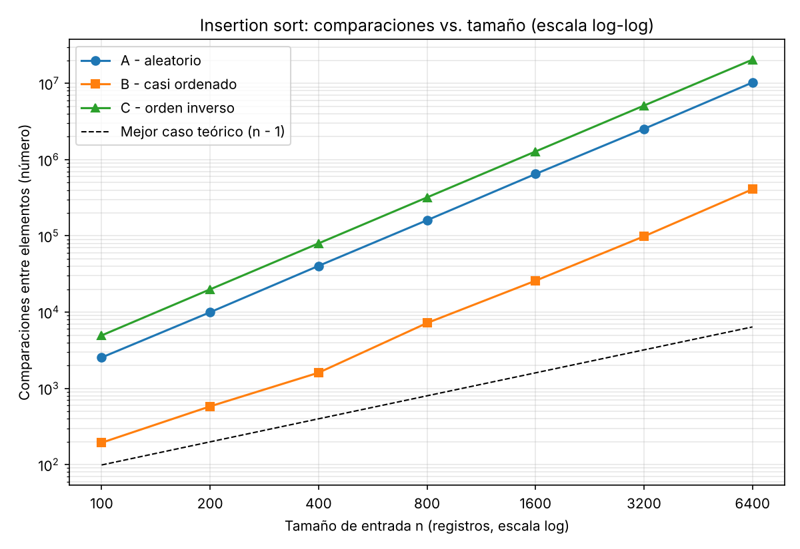
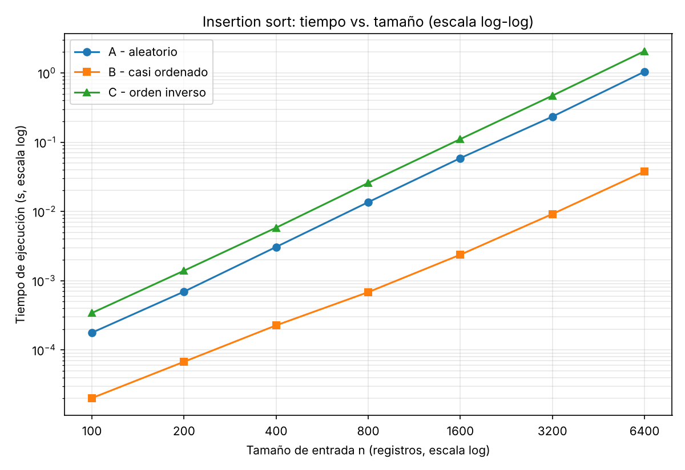
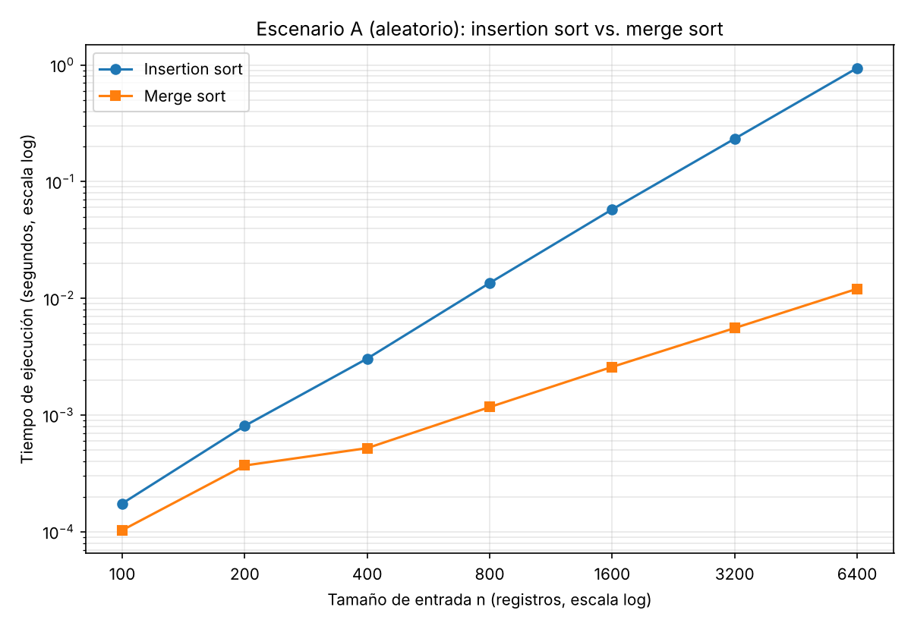

# Laboratorio 1: Fundamentos, complejidad y recurrencias (Plataforma Tamiza)

**Nombre:** Yhann Camilo Carmona
**Curso:** Análisis de Algoritmos, Ingeniería de Sistemas

## Instrucciones para reproducir el experimento

El código está en esta misma carpeta:

| Archivo                                          | Contenido                                                              |
| ------------------------------------------------ | ---------------------------------------------------------------------- |
| [`algoritmos.py`](algoritmos.py)                 | `insertion_sort` y `merge_sort` instrumentados (cuentan comparaciones) |
| [`datos.py`](datos.py)                           | Generadores de los escenarios A, B y C de Tamiza                       |
| [`parte3_casos.py`](parte3_casos.py)             | Experimento de la Parte 3: insertion sort en los tres escenarios       |
| [`parte4_complejidad.py`](parte4_complejidad.py) | Experimento de la Parte 4: insertion sort vs. merge sort               |

Se necesita Python 3.9 o superior; las dependencias (matplotlib) están en `requirements.txt`, en la raíz del repositorio. Las Partes 1 y 2 son solo texto y no tienen código.

```powershell
# 1. Desde la raíz del repositorio: crear (si hace falta) y activar el entorno
python -m venv venv
.\venv\Scripts\Activate.ps1          # en macOS/Linux: source venv/bin/activate
pip install -r requirements.txt

# 2. Entrar a la carpeta del laboratorio
cd laboratorios\lab1-fundamentos-complejidad-recurrencias

# 3. Ejecutar cada parte (cada comando regenera sus gráficas en graficas/)
python parte3_casos.py          # Parte 3: genera parte3_comparaciones.png y parte3_tiempo.png
python parte4_complejidad.py    # Parte 4: genera parte4_tiempo.png
```

---

# Parte 1: Analizar el algoritmo antes de comprar hardware

**Pregunta:** La Secretaría está por firmar la compra de un servidor del doble de velocidad para que el proceso de Tamiza quepa en la ventana de cuatro horas. ¿Por qué debe analizarse primero el algoritmo, si el que está en producción lleva ocho años entregando el resultado correcto?

## Corrección y eficiencia no son lo mismo

Para mí, un algoritmo es _correcto_ si, para toda entrada válida, termina y entrega la salida que se pide. Tamiza lo cumple: insertion sort siempre devuelve los registros ordenados de mayor a menor riesgo. La _eficiencia_ mide otra cosa: cuánto de un recurso consume el algoritmo cuando crece la entrada. Aquí el recurso es el tiempo de ejecución, y se mide contra la restricción de cerrar antes de las 6:00 a. m.

La corrección dice qué sale, pero no dice cuánto tarda en salir. Un algoritmo puede dar siempre la respuesta correcta y aun así no servir si la da tarde. Tamiza incumple la ventana de cuatro horas (2:00 a. m. a 6:00 a. m.): con la lista incompleta, el centro de contacto llamó sin orden de riesgo. Por eso las tres fallas recientes no son un error de lógica, son un incumplimiento de tiempo.

## Por qué el servidor del doble de velocidad no resuelve el problema de fondo

Insertion sort, en el caso aleatorio, hace del orden de n² operaciones. Hace ocho años n era unos 20.000 y hoy es 1.200.000, es decir, 60 veces más datos. El trabajo no se multiplicó por 60 sino por 60² = 3.600. Un servidor del doble de velocidad divide el tiempo entre 2 y no toca ese factor de 3.600.

Además, como el costo crece con n², si los datos se duplican el trabajo se cuatriplica. La máquina nueva solo aguantaría unas √2 ≈ 1,4 veces más registros antes de volver a desbordar la ventana. Estaríamos pagando por posponer la falla, no por quitarla.

Un algoritmo como merge sort, del orden de n log n, haría unas 1,2·10⁶ × 20 ≈ 2,4·10⁷ operaciones. Comparado con n², eso es una mejora de decenas de miles de veces, y ningún reloj más rápido la alcanza. El análisis también muestra que el escenario importa. En el B (casi ordenado) insertion sort se acerca a n, pero en A y C no.

## Segundo ejemplo: conciliación de pagos de una tienda en línea

Imagine un script que, cada noche, cruza 2.000.000 de movimientos del banco con 2.000.000 de pedidos de la tienda, usando dos ciclos `for` anidados. Es correcto: encuentra todos los pagos que coinciden. Pero hace unas 4·10¹² comparaciones. Si el equipo hace del orden de 10⁸ a 10⁹ comparaciones por segundo, eso toma entre 1 y 11 horas. La restricción incumplida es que el reporte debe estar listo en una hora, antes de que abra contabilidad. Ordenar una de las listas, o guardarla en una tabla hash, lo reduce a del orden de n log n o n operaciones. No hace falta cambiar de máquina.

## Concepto

No se debe firmar la compra todavía. Primero hay que analizar el algoritmo y medir cómo crece su costo en tiempo con n, porque el hardware no cambia ese crecimiento y solo lo desplaza un poco.

---

# Parte 2: Responsabilidad ambiental y ética de la implementación

**Pregunta:** Como responsable técnico de Tamiza, ¿qué responsabilidad ambiental y ética asume al decidir qué algoritmo de ordenamiento se ejecuta cada madrugada sobre los datos de 1.200.000 pacientes?

## Dimensión ambiental

La energía que gasta un computador es, aproximadamente, su potencia por el tiempo que trabaja (E = P × t). Si el proceso nocturno mantiene el servidor a plena carga durante toda la ventana, cada hora de ejecución se vuelve kilovatios-hora. Como ejemplo supuesto (no medido): un servidor de unos 300 W que trabaja 4 horas gasta 1,2 kWh por noche. Un algoritmo de orden n log n terminaría en pocos minutos y gastaría una fracción pequeña de eso.

La diferencia se multiplica porque el proceso corre todas las madrugadas: 1,2 kWh × 365 noches ≈ 440 kWh al año, y unos 3.500 kWh en ocho años, por una decisión que se tomó una sola vez. Además, con un costo de orden n², cada vez que crecen los datos el consumo crece más rápido que ellos. Duplicar la velocidad del servidor tampoco es neutro: es una máquina más potente, con su propia huella de fabricación, para correr el mismo algoritmo lento. Cambiar el algoritmo es la forma más barata de gastar menos energía, porque el ahorro se repite todos los días.

## Dimensión ética

**Caso 1: el paciente de riesgo alto.** Pensemos en una persona con índice 950. Si el proceso no termina y la lista queda parcial y sin ordenar, a esa persona la pueden llamar de las últimas o no llamarla ese día, y su valoración médica se retrasa. _¿Quién asume el costo?_ El paciente, y es el costo más grave: es de salud y no se puede devolver. La Secretaría lo asume después, como responsabilidad institucional.

**Caso 2: el operador del centro de contacto.** A las 6:00 a. m. recibe una lista incompleta y desordenada. Pasa la jornada llamando a personas de bajo riesgo mientras hay otras más graves sin contactar, y es quien habla con el paciente cuando este pregunta por qué lo llamaron tarde. _¿Quién asume el costo?_ El operador, en desgaste y carga moral, aunque no eligió el algoritmo ni el servidor.

El equipo de desarrollo casi no paga el costo directo del error: lo pagan quienes tienen menos poder de decisión. Esa asimetría es la razón por la que la responsabilidad recae en quien decide, es decir, en mí.

## Tensión propia del caso: el orden decide a quién se llama primero

En un ordenamiento común, un error es una molestia. Aquí el orden es la decisión clínica, así que la corrección exige más que terminar a tiempo:

- **Completitud:** cada registro debe aparecer exactamente una vez; ninguno se pierde ni se duplica.
- **Orden verificado:** conviene comprobar al final que la lista quedó de mayor a menor riesgo, y no suponerlo.
- **Empates:** el índice va de 0 a 1000 y hay 1.200.000 registros, así que habrá muchísimos empates. Necesito una regla explícita y estable (por ejemplo, el resultado más antiguo primero) y no un desempate arbitrario. Merge sort es estable.
- **Fallar bien:** si el tiempo se agota, entregar una lista parcial sin orden es el peor resultado. Es preferible garantizar que lo entregado sea el tramo de mayor riesgo, ya ordenado, y avisar que la lista está incompleta.
  Aquí tiempo y corrección no son independientes: una lista correcta que llega tarde equivale, para el paciente de riesgo alto, a una lista incorrecta.

---

# Parte 3: Peor caso, mejor caso y caso promedio

**Código:** [código de la Parte 3](parte3_casos.py), con los algoritmos en [`algoritmos.py`](algoritmos.py) y los generadores en [`datos.py`](datos.py).

## 3.1 Explicación

Para hablar de los tres casos primero hay que fijar el tamaño de la entrada. En Tamiza, n = 1.200.000 registros con índice de riesgo entre 0 y 1000. El **conjunto de entradas** son todas las listas posibles de ese tamaño, es decir, todas las formas en que los registros pueden llegar acomodados. El caso describe qué operación estadística se hace sobre el costo del algoritmo (comparaciones y desplazamientos) a lo largo de ese conjunto:

- **Peor caso:** el _máximo_ del costo sobre todas las entradas de tamaño n. Para insertion sort es n(n−1)/2 ≈ 7,2·10¹¹ operaciones, cuando cada registro nuevo tiene que recorrer toda la parte ya ordenada.
- **Mejor caso:** el _mínimo_ del costo sobre esas mismas entradas. Para insertion sort es n−1 ≈ 1,2·10⁶ comparaciones, cuando la lista ya viene en el orden pedido y nada se desplaza.
- **Caso promedio:** el _promedio_ del costo sobre todas las entradas de tamaño n, suponiendo una distribución de probabilidad sobre ellas (aquí, que todos los acomodos son igual de probables). Para insertion sort es cerca de n²/4 ≈ 3,6·10¹¹.
  El peor y el mejor caso son propiedades del algoritmo y de n, no de "un mal día". El promedio, además, depende de la distribución que yo suponga, y si los datos reales no la cumplen, el número no sirve.

### ¿Cuál caso usaría para decidir si entra en producción?

El **peor caso**. La ventana de cuatro horas es estricta: una sola noche que se pase deja al centro de contacto sin lista ordenada, y ya vimos que eso perjudica a pacientes concretos. El peor caso es el único que da una garantía de tiempo para cualquier lote que llegue. El mejor caso no garantiza nada, porque depende de que la suerte acomode los datos. El caso promedio sirve para estimar el consumo energético típico, pero no para firmar un compromiso de tiempo, porque el lote del escenario C no es una rareza hipotética: llega por una migración real.

### Predicción (antes de medir)

Como Tamiza necesita la lista **de mayor a menor** riesgo:

| Escenario            | Mi predicción para insertion sort                                                                                                                                                                                                                                                                                                                                       |
| -------------------- | ----------------------------------------------------------------------------------------------------------------------------------------------------------------------------------------------------------------------------------------------------------------------------------------------------------------------------------------------------------------------- |
| **A, aleatorio**     | Caso promedio: del orden de n²/4.                                                                                                                                                                                                                                                                                                                                       |
| **B, casi ordenado** | Lo más cercano al mejor caso entre los tres escenarios. Pero no es el mejor caso exacto: el 2 % nuevo (unos 24.000 registros) se anexa sin ordenar, y cada uno tiene que desplazarse en promedio medio camino por la lista ya ordenada. Estimo del orden de 1,4·10¹⁰ operaciones: unas 25 veces menos que A, pero miles de veces más que el mejor caso verdadero (n−1). |
| **C, orden inverso** | **Peor caso**: el sistema legado exporta de menor a mayor, o sea justo al revés de lo pedido, y cada registro recorre toda la parte ordenada. Estimo cerca de n²/2.                                                                                                                                                                                                     |

Una precisión sobre los empates: como el índice solo toma 1001 valores, habrá muchos registros con el mismo índice. Con comparación estricta, insertion sort no mueve registros iguales entre sí, así que A y C deberían quedar un poco por debajo de n²/4 y n²/2. La diferencia debería ser de alrededor de 0,1 %, y no debería cambiar la conclusión.

## 3.2 Demostración experimental

**Cómo se ejecuta:** `python3 parte3_casos.py` (genera las dos gráficas en `graficas/`). Archivos: `algoritmos.py` (insertion sort instrumentado), `datos.py` (los tres generadores) y `parte3_casos.py` (el experimento).

**Decisiones de implementación**

- `insertion_sort` produce orden **descendente** (mayor riesgo primero), que es lo que Tamiza necesita. Trabaja sobre una copia y cuenta solo la comparación `resultado[j] < clave`; la condición `j >= 0` no se cuenta.
- El enunciado pide índices **distintos entre sí** y tamaños de hasta 6.400, pero el índice real de Tamiza solo toma 1001 valores (0 a 1000). Para que sean distintos usé los enteros 0 a n−1 como índices en el experimento. Esto cambia los empates respecto al caso real, pero no la forma del crecimiento.
- Escenario B: el 98 % ya viene en orden descendente y el 2 % restante (sorteado con la semilla) se anexa desordenado al final. Escenario C: lista ascendente, exactamente al revés de lo pedido.
- El tiempo es el mínimo de 3 repeticiones y mide solo la llamada a `insertion_sort`, no la generación de datos. Cada corrida verifica que la lista original no cambió, que la salida quedó de mayor a menor y que no se perdió ni duplicó ningún registro.
- No se usó `sorted()`, `list.sort()` ni ninguna librería de ordenamiento, tampoco en los generadores (el escenario B se arma recorriendo valores de mayor a menor).

### Resultados

|     n | A: comparaciones | B: comparaciones | C: comparaciones | A: tiempo (s) | B: tiempo (s) | C: tiempo (s) |
| ----: | ---------------: | ---------------: | ---------------: | ------------: | ------------: | ------------: |
|   100 |            2.542 |              194 |            4.950 |       0,00018 |       0,00002 |       0,00034 |
|   200 |            9.970 |              581 |           19.900 |       0,00069 |       0,00007 |       0,00139 |
|   400 |           40.436 |            1.606 |           79.800 |       0,00306 |       0,00023 |       0,00582 |
|   800 |          160.484 |            7.201 |          319.600 |       0,01360 |       0,00068 |       0,02580 |
| 1.600 |          648.481 |           25.832 |        1.279.200 |       0,05883 |       0,00237 |       0,11077 |
| 3.200 |        2.533.103 |           98.648 |        5.118.400 |       0,23394 |       0,00917 |       0,46980 |
| 6.400 |       10.276.753 |          409.004 |       20.476.800 |       1,04321 |       0,03778 |       2,06766 |





_Las gráficas están en escala log-log para que los tres escenarios se vean en los mismos ejes; en lineal, B quedaría pegado al eje. En log-log, una recta con pendiente 2 es un crecimiento cuadrático (n²) y una con pendiente 1 es lineal._

### ¿Qué escenario fue cada caso?

- **Peor caso: escenario C (orden inverso).** Las comparaciones dan n(n−1)/2 de forma exacta (20.476.800 para n = 6.400), y la razón comparaciones/n² se estabiliza en 0,5. Es el máximo posible: cada registro recorre toda la parte ya ordenada.
- **Caso promedio: escenario A (aleatorio).** La razón comparaciones/n² se mantiene alrededor de 0,25, es decir n²/4. Cada vez que n se duplica, las comparaciones se multiplican por 4. Coincide con lo que se espera de un orden uniformemente aleatorio.
- **Más cercano al mejor caso: escenario B (casi ordenado).** Es el que menos trabaja de los tres, unas 25 veces menos que A. Pero **no es el mejor caso verdadero**, que sería una lista ya ordenada con n−1 = 6.399 comparaciones. B hizo 409.004, unas 64 veces más. En el experimento, ningún escenario es exactamente el mejor caso.

### Contraste con la predicción de 3.1

La predicción se cumplió en lo cualitativo y en lo cuantitativo, así que no hubo contradicción que explicar:

- **C = peor caso:** acertó. Estimé cerca de n²/2 y el resultado fue n(n−1)/2 exacto.
- **A = promedio:** acertó, con razón ≈ 0,25. Como había predicho, los empates no cambiaron la conclusión; en el experimento ni siquiera hay empates porque los índices son distintos.
- **B cerca del mejor caso, pero no igual:** acertó. Predije que B era unas 25 veces más barato que A, y salió 10.276.753 / 409.004 ≈ 25,1. También predije un costo de alrededor de 0,01·n² (el 2 % nuevo, cada uno con medio camino por recorrer) y salió 0,0100 para n = 6.400. Para n = 1.200.000 eso da unos 1,4·10¹⁰, que fue el número que escribí.
- **Lo que la predicción no decía y los datos sí muestran:** B sigue siendo **cuadrático**. Su razón comparaciones/n² se estabiliza en 0,01 y no en cero. Que el 98 % venga ordenado no basta: un 2 % fijo de registros desordenados mantiene el costo en el orden de n².
- **El tiempo sigue a las comparaciones:** el costo por comparación fue parecido en los tres escenarios (unos 100 ns en A y en C, y 92 ns en B, en Python y en mi máquina), así que la forma de las curvas de tiempo es la de las comparaciones. Las diferencias en n pequeños son ruido de medición.

**Un comentario para la decisión de Tamiza.** Estos tiempos son de Python en un equipo de prueba, no del servidor de Tamiza, así que sirven para comparar la _forma_ del crecimiento y no para predecir horas exactas. Aun así, como orden de magnitud, extrapolando a n = 1.200.000 con esos costos por comparación saldrían unas 10 h para A, unas 20 h para C y unos 22 min para B. Es decir, A y C no caben en la ventana de cuatro horas y B sí. Eso refuerza lo dicho en 3.1: el peor caso es el que hay que mirar, porque el escenario C es real.

---

# Parte 4: Complejidad de merge sort e insertion sort

**Código:** [código de la Parte 4](parte4_complejidad.py), con los algoritmos en [`algoritmos.py`](algoritmos.py) y los generadores en [`datos.py`](datos.py).

## 4.1 Cálculo teórico

### Recurrencia de merge sort

```
T(n) = 2·T(n/2) + Θ(n)        con T(1) = Θ(1)
```

Cada término sale de un paso del algoritmo:

- **Dividir:** hallar el punto medio de la lista cuesta tiempo constante, Θ(1). En mi implementación el corte con `lista[:medio]` copia elementos y cuesta Θ(n), pero eso queda absorbido por el término lineal de combinar.
- **Conquistar, `2·T(n/2)`:** la lista se parte en **2 subproblemas**, cada uno de tamaño **n/2** (ignoro pisos y techos), y cada uno se ordena con la misma función.
- **Combinar, `Θ(n)`:** mezclar dos listas ya ordenadas de n/2 elementos cuesta tiempo lineal. Cada comparación pone un elemento en su lugar definitivo, y cuando una mitad se acaba, el resto de la otra se copia sin comparar. Son como mucho n−1 comparaciones y n copias.

### Resolución por árbol de recursión

Llamo `c` a la constante del costo de combinar, de modo que mezclar un subproblema de tamaño m cuesta `c·m`.

```
nivel 0:                    c·n                              costo del nivel: c·n
                         /        \
nivel 1:           c·n/2            c·n/2                    2 · (c·n/2)  = c·n
                   /    \           /    \
nivel 2:      c·n/4  c·n/4      c·n/4  c·n/4                 4 · (c·n/4)  = c·n
                .....
nivel k:      2^k nodos, cada uno de costo c·n/2^k           2^k · (c·n/2^k) = c·n
                .....
nivel log2 n: n hojas, cada una de tamaño 1 y costo c        n · c        = c·n
```

1. **Costo por nivel.** En el nivel k hay 2^k subproblemas de tamaño n/2^k. Su costo total es 2^k · c·n/2^k = c·n, el mismo en todos los niveles.
2. **Número de niveles.** Los subproblemas dejan de dividirse cuando n/2^k = 1, es decir k = log₂ n. Contando el nivel 0, hay **log₂ n + 1 niveles**.
3. **Costo total.** Se suman los niveles: T(n) = c·n · (log₂ n + 1) = c·n·log₂ n + c·n.
4. **Cota.** El término dominante es c·n·log₂ n, así que **T(n) = Θ(n log n)**.

_Comprobación cruzada con el método maestro:_ a = 2, b = 2, f(n) = Θ(n). Como n^(log_b a) = n¹ = n, se cumple f(n) = Θ(n^(log_b a)), que es el caso 2, y da Θ(n log n). Coincide con el árbol.

_Comprobación con el experimento:_ para n = 6.400 el peor caso esperado es n·log₂ n − n + 1 ≈ 74.500 comparaciones, y en el escenario A medí 72.967.

### Insertion sort, línea a línea

Uso las líneas de mi implementación (sin comentarios). `k_i` es el número de desplazamientos que hace el elemento `i`, y `K = Σ k_i` es el total de desplazamientos (el número de pares fuera de orden).

| Línea                           | Costo | Veces que se ejecuta   |
| ------------------------------- | ----- | ---------------------- |
| `resultado = list(datos)`       | c₁    | 1                      |
| `comparaciones = 0`             | c₂    | 1                      |
| `for i in range(1, n):`         | c₃    | n                      |
| `clave = resultado[i]`          | c₄    | n − 1                  |
| `j = i - 1`                     | c₅    | n − 1                  |
| `while j >= 0:`                 | c₆    | Σ (kᵢ + 1) = K + n − 1 |
| `comparaciones += 1`            | c₇    | a lo sumo K + n − 1    |
| `if resultado[j] < clave:`      | c₈    | a lo sumo K + n − 1    |
| `resultado[j+1] = resultado[j]` | c₉    | K                      |
| `j -= 1`                        | c₁₀   | K                      |
| `break` (rama `else`)           | c₁₁   | a lo sumo n − 1        |
| `resultado[j+1] = clave`        | c₁₂   | n − 1                  |

Sumando costo × veces:

```
T(n) = a·K + b·n + c₀
   con a  = c₆+c₇+c₈+c₉+c₁₀                      (costo de cada desplazamiento)
       b  = c₃+c₄+c₅+c₆+c₇+c₈+c₁₁+c₁₂            (costo fijo por elemento)
       c₀ = una constante que no depende de n
```

Todo depende de K, que depende de cómo llegue la entrada:

- **Mejor caso:** la lista ya viene en el orden pedido, nadie se desplaza y K = 0. Queda T(n) = b·n + c₀, que es **Θ(n)**. (Experimento: n − 1 comparaciones.)
- **Peor caso:** la lista viene al revés, el elemento `i` se desplaza `i` veces y K = 1 + 2 + … + (n−1) = n(n−1)/2. Queda T(n) = (a/2)·n² + (b − a/2)·n + c₀, que es **Θ(n²)**. (Experimento: n(n−1)/2 comparaciones exactas.)
- **Caso promedio:** si todos los acomodos son igual de probables y los valores son distintos, cada par de elementos está fuera de orden con probabilidad 1/2. Entonces el valor esperado es K = n(n−1)/4, y T(n) es **Θ(n²)**. (Experimento: razón comparaciones/n² ≈ 0,25.)

### Complejidad esperada

| Algoritmo      | Mejor caso | Peor caso  | Caso promedio | Memoria adicional         |
| -------------- | ---------- | ---------- | ------------- | ------------------------- |
| Insertion sort | Θ(n)       | Θ(n²)      | Θ(n²)         | O(1) (además de la copia) |
| Merge sort     | Θ(n log n) | Θ(n log n) | Θ(n log n)    | O(n)                      |

Merge sort no cambia de orden de crecimiento según la entrada, porque siempre hace el mismo árbol de divisiones. Lo único que varía es la constante: entre ½·n·log₂ n y n·log₂ n − n + 1 comparaciones.

## 4.2 Validación experimental

**Cómo se ejecuta:** `python3 parte4_complejidad.py`. Agregué `merge_sort` a `algoritmos.py` (devuelve orden descendente, trabaja sobre una copia y cuenta solo las comparaciones de la mezcla). Mide los dos algoritmos sobre el escenario A, con los mismos tamaños de la Parte 3 y `time.perf_counter()`, y cronometra solo la llamada al algoritmo.

|     n | Insertion sort (s) | Merge sort (s) | Razón insertion / merge |
| ----: | -----------------: | -------------: | ----------------------: |
|   100 |            0,00017 |        0,00010 |                     1,7 |
|   200 |            0,00081 |        0,00037 |                     2,2 |
|   400 |            0,00305 |        0,00052 |                     5,9 |
|   800 |            0,01356 |        0,00117 |                    11,6 |
| 1.600 |            0,05783 |        0,00259 |                    22,3 |
| 3.200 |            0,23314 |        0,00556 |                    41,9 |
| 6.400 |            0,93985 |        0,01208 |                    77,8 |



_Escala log-log. Aquí una recta de pendiente 2 indica crecimiento cuadrático, y una de pendiente cercana a 1 indica crecimiento casi lineal._

### Qué muestra la gráfica

- **Insertion sort** es una recta empinada: cada vez que n se duplica, el tiempo se multiplica por cerca de 4 (de 0,233 s a 0,940 s al pasar de 3.200 a 6.400). Es el comportamiento cuadrático.
- **Merge sort** es una curva mucho más plana: al duplicar n, el tiempo se multiplica por poco más de 2 (de 0,0056 s a 0,0121 s en el mismo salto). Es lo que se espera de n log n.
- **La distancia entre las dos curvas crece.** La razón insertion/merge pasa de 1,7 con n = 100 a 78 con n = 6.400, y desde n = 200 casi se duplica cada vez que n se duplica.

**Conclusión: para Tamiza es mejor merge sort**, porque su tiempo crece mucho más despacio con el número de registros, y Tamiza ya pasó de 20.000 a 1.200.000. Con 6.400 registros ya es unas 78 veces más rápido, y la brecha sigue abriéndose.

### Contraste con 4.1

La conclusión **coincide** con las complejidades calculadas: Θ(n²) para insertion sort en el caso promedio (escenario A) y Θ(n log n) para merge sort. Las pendientes de la gráfica (≈ 4× y ≈ 2× por cada duplicación de n) son las que predice la teoría.

**Tamaños pequeños.** Esperaba que insertion sort pudiera ganar con pocos datos, porque no tiene la sobrecarga de dividir y copiar listas. En mis mediciones eso no pasó: incluso con n = 100 merge sort ya fue más rápido (0,10 ms contra 0,17 ms). Lo que sí se nota es que las dos curvas están muy juntas ahí, y que a partir de n = 100 la diferencia es de décimas de milisegundo, así que no importa en la práctica. Una explicación posible, que no probé por separado: con n = 100 insertion sort ya hace unas 5 veces más comparaciones (2.542 contra 547), y esa diferencia pesa más que la sobrecarga de dividir y copiar listas.

## 4.3 Concepto técnico para la Secretaría de Salud

**Para:** equipo de ingeniería, Secretaría de Salud departamental.

**Recomendación.** Reemplazar insertion sort por **merge sort** como única implementación. El criterio fue elegir el algoritmo cuyo desempeño no dependa del canal de origen. Como el canal puede cambiar sin aviso y no conviene mantener tres implementaciones, no sirve el algoritmo que gana en el escenario más probable: sirve el que no pierde en ninguno. Con n = 6.400, merge sort tardó 0,012 s (escenario A), 0,009 s (B) y 0,008 s (C). Insertion sort tardó 0,94 s, 0,037 s y 1,89 s: una variación de unas 51 veces entre canales. Incluso en B, el favorable a insertion sort, merge sort fue más rápido (0,009 s contra 0,037 s).

**¿Cabe en la ventana de cuatro horas (14.400 s) con 1.200.000 registros?** Lo estimo por extrapolación, no por medición. Tomé el tiempo medido con n = 6.400 y lo escalé según el orden de crecimiento: dividí entre n² para insertion sort y entre n·log₂ n para merge sort, y multipliqué por el valor de n de Tamiza.

| Escenario        | Insertion sort (actual) | Merge sort |
| ---------------- | ----------------------- | ---------- |
| A, aleatorio     | ≈ 9,2 h (no cabe)       | ≈ 4 s      |
| B, casi ordenado | ≈ 22 min                | ≈ 3 s      |
| C, orden inverso | ≈ 18,5 h (no cabe)      | ≈ 2,5 s    |

Es una estimación hecha en Python, con un salto de unas 190 veces en n, y la memoria caché puede mover las constantes. Aun así, si merge sort estuviera subestimado 100 veces, tomaría unos 6 minutos. En cambio, insertion sort excede la ventana por un factor de 2,3 (A) a 4,6 (C), y esa diferencia viene del orden de crecimiento, no de la constante.

**Sobre el servidor del doble de velocidad.** En la gráfica `parte4_tiempo.png`, con n = 6.400, insertion sort tarda ≈ 0,94 s y merge sort ≈ 0,012 s. Un servidor del doble de velocidad bajaría el primero a ≈ 0,47 s, que sigue siendo unas 39 veces más lento que merge sort en el servidor actual. Además, la brecha crece con n (1,7 veces con n = 100, 78 veces con n = 6.400). Con el servidor nuevo, la estimación para A baja a unas 4,6 h, todavía fuera de la ventana. **No recomiendo la compra.**

**Otras consideraciones.**

- **Memoria:** merge sort necesita memoria adicional proporcional a n. Con n = 6.400 su pico fue de 154,6 KiB contra 50,2 KiB de insertion sort, unas 3 veces más. Extrapolado a 1.200.000 serían decenas de MiB, irrelevantes en un servidor.
- **Estabilidad:** el índice solo toma 1.001 valores, así que con 1.200.000 registros habrá muchísimos empates. Ambas implementaciones conservan el orden de llegada entre registros con el mismo índice, porque insertion sort solo desplaza con `<` estricto y merge sort toma primero el elemento de la izquierda en un empate. Esto se asegura por construcción, no lo medí; recomiendo una prueba automática que lo verifique.
- **Riesgo del escenario B:** insertion sort solo rinde en B mientras el reproceso siga entregando una lista casi ordenada. Si cambia el flujo, vuelve a ser cuadrático: con n = 6.400 pasó de 0,037 s en B a 0,94 s en A, unas 25 veces más. Merge sort no tiene ese riesgo.
- **Mantenimiento:** una sola implementación con pruebas automáticas (orden descendente, sin registros perdidos ni duplicados) y una alarma si el proceso supera la mitad de la ventana.
