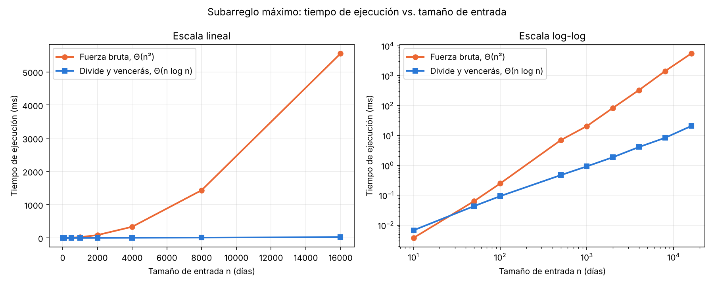

# Laboratorio 2: Divide y vencerás (subarreglo máximo)

**Nombre:** Yhann Camilo Carmona
**Curso:** Análisis de Algoritmos, Ingeniería de Sistemas

## Instrucciones para reproducir el experimento

Se necesita Python 3.9 o superior; matplotlib está en `requirements.txt`, en la raíz del repositorio.

```powershell
# 1. Desde la raíz del repositorio: activar el entorno e instalar dependencias
.\venv\Scripts\Activate.ps1          # en macOS/Linux: source venv/bin/activate
pip install -r requirements.txt

# 2. Entrar a la carpeta del laboratorio
cd laboratorios\lab2-divide-y-vencer

# 3. Pruebas (imprime "Todas las pruebas pasaron.")
python pruebas.py

# 4. Medición (imprime la tabla y regenera graficas/tiempo_vs_n.png; tarda ~1 minuto)
python medicion.py
```

---

# Parte 1: Implementar y verificar

Código: [`subarreglo.py`](subarreglo.py) y [`pruebas.py`](pruebas.py).

Verifiqué las tres funciones (`subarreglo_fuerza_bruta`, `suma_cruzada` y `subarreglo_maximo`) con `assert` en `pruebas.py`. Casos cubiertos:

- La serie de ocho días de la situación problema: suma 17, tramo del día 2 al 7.
- Un solo elemento (positivo, negativo y cero).
- Todos los valores negativos (gana el día menos malo) y todos positivos (gana la serie completa).
- Un caso donde el mejor tramo cruza el punto medio, comprobando también `suma_cruzada` por separado.
- Series con ceros y empates, donde solo comparo la suma.
- 200 listas aleatorias (semilla fija, longitud de 1 a 60) en las que ambos algoritmos deben dar la misma suma.

En cada caso también compruebo que el tramo devuelto suma de verdad lo que dice y que la lista de entrada no fue modificada. `subarreglo_maximo` no llama a la fuerza bruta.

---

# Parte 2: Medir y graficar

Código: [`medicion.py`](medicion.py).



**Cómo medí.** Tamaños: 10, 50, 100, 500, 1000, 2000, 4000, 8000 y 16000. Los datos son enteros entre -100 y 100, generados con semilla fija (2026), y ambos algoritmos reciben la misma lista en cada tamaño. Cronometré solo la llamada al algoritmo con `time.perf_counter()`. Repetí cada medición (de 200 veces en n=10 a 3 veces en n=16000) y reporto la mediana para reducir el ruido del sistema. Dentro del experimento verifico que ambas sumas coincidan en cada tamaño. Resultados (ms):

| n | Fuerza bruta | Divide y vencerás |
| ---: | ---: | ---: |
| 10 | 0,0038 | 0,0068 |
| 50 | 0,0639 | 0,0437 |
| 100 | 0,2496 | 0,0940 |
| 500 | 7,026 | 0,4745 |
| 1000 | 20,72 | 0,9318 |
| 2000 | 84,24 | 1,885 |
| 4000 | 333,1 | 4,136 |
| 8000 | 1434,6 | 8,413 |
| 16000 | 5551,6 | 20,81 |

---

# Parte 3: Análisis

**1. Recurrencia.** En `subarreglo_maximo` divido el rango en dos mitades y resuelvo cada una: eso son 2 subproblemas de tamaño n/2. El caso cruzado recorre el rango una vez hacia cada lado del punto medio, así que cuesta Θ(n); comparar los tres candidatos es Θ(1). Queda T(n) = 2T(n/2) + Θ(n), con T(1) = Θ(1). Con el método maestro, a = 2, b = 2 y n^(log₂2) = n. Como f(n) = Θ(n) = Θ(n^(log_b a)), aplica el caso 2 y T(n) = Θ(n log n). La fuerza bruta prueba todos los pares (i, j) con i ≤ j, que son n(n+1)/2. Como acumulo la suma dentro del ciclo, cada par cuesta Θ(1), y el total es Θ(n²).

**2. Lo medido contra lo esperado.** En la gráfica lineal la curva de fuerza bruta se dispara (5,5 s en n=16000) mientras la de divide y vencerás casi parece plana (20,8 ms). Al duplicar de 4000 a 8000, la fuerza bruta se multiplicó por 1434,6/333,1 ≈ 4,3 y divide y vencerás por 8,41/4,14 ≈ 2,0. De 8000 a 16000 fueron ≈ 3,9 y ≈ 2,5. Θ(n²) predice 4, y coincide. Θ(n log n) predice cerca de 2,15 (2·log 8000/log 4000); lo medido anda en 2,0 a 2,5, así que coincide con ruido.

**3. Tamaños pequeños.** Sí hay cruce. En n=10 la fuerza bruta es más rápida (0,0038 ms contra 0,0068 ms) y en n=50 ya gana divide y vencerás (0,0437 contra 0,0639 ms); en la gráfica log-log las curvas se cruzan entre ambos tamaños. Antes del cruce, el costo de las llamadas recursivas y de los dos barridos del caso cruzado pesa más que el ahorro asintótico; la fuerza bruta tiene un ciclo muy simple. La ventaja solo se vuelve grande después: en n=500 ya es 15 veces.

**4. ¿Cuándo conviene dividir?** Para el máximo de un arreglo, dividir en mitades da T(n) = 2T(n/2) + Θ(1). Con el método maestro, n^(log₂2) = n domina a f(n) = Θ(1), así que T(n) = Θ(n): lo mismo que recorrerlo una vez, pero con recursión de sobra. Dividir no mejora porque combinar (una comparación) es barato, pero el trabajo total sigue siendo mirar cada elemento. En el subarreglo máximo sí sirve porque la alternativa era Θ(n²) y combinar cuesta solo Θ(n): al dividir se ahorra revisar los pares que quedan dentro de cada mitad por separado. Dividir conviene cuando el método directo es peor que lo que cuesta dividir y combinar.

**5. Concepto para la gerente.** Recomiendo divide y vencerás. Con 2000 días por tienda la diferencia es de 84 ms contra 1,9 ms por tienda (1500 tiendas: unos 126 s contra 3 s), pero lo decisivo son las series de sensores. **Estimación** para 1.000.000 de registros, que no medí: con el tiempo de n=16000 calculo una constante para cada fórmula, c = 5551,6 ms/16000² para n² y c = 20,81 ms/(16000·log₂16000) para n log n, y las evalúo en 10⁶. La fuerza bruta tardaría unos 2,2·10⁷ ms, es decir, cerca de 6 horas; divide y vencerás, cerca de 1,9 s. Una regla de tres lineal subestimaría mucho la fuerza bruta, porque su tiempo crece con n². La estimación ignora efectos de memoria, así que es un orden de magnitud, no un valor exacto.
