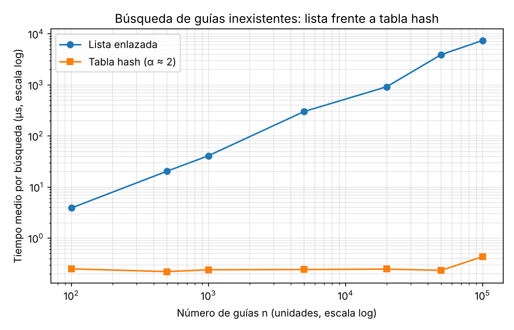
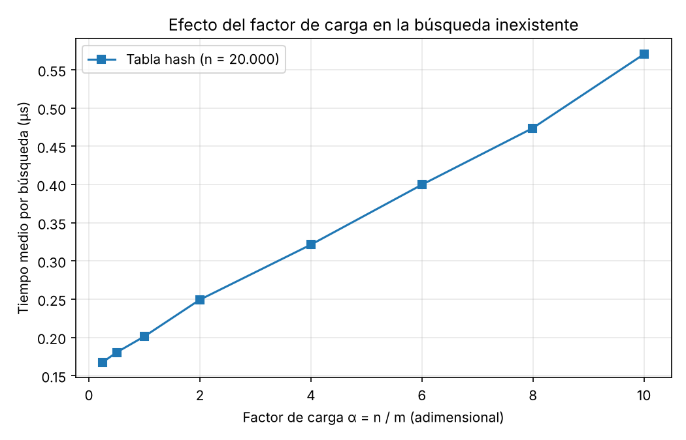

# Laboratorio 3 — Estructuras de datos: lista enlazada frente a tabla hash

**Nombre:** Yhann Camilo Carmona — Análisis de Algoritmos, Ingeniería de Sistemas

## Cómo reproducir

Desde la raíz del repositorio, con el entorno virtual (matplotlib ya está en `requirements.txt`):

```bash
venv\Scripts\activate          # Windows (en Linux/macOS: source venv/bin/activate)
cd laboratorios/lab3-estructuras-datos
python pruebas.py              # imprime "Todas las pruebas pasaron."
python medicion.py             # imprime las tablas y regenera graficas/*.png
```

## Parte 1 — Implementación y verificación

Código: [estructuras.py](estructuras.py) · Pruebas: [pruebas.py](pruebas.py)

`TablaHash` reutiliza `ListaEnlazada` en cada casilla (encadenamiento) y usa `h(k) = k mod m`; no se usa `dict`, `set` ni `hash()`. Las pruebas con `assert` cubren:

- búsqueda exitosa e infructuosa en lista y tabla, también con la estructura vacía, e inserción al inicio (la cabeza es la última guía insertada);
- colisión forzada con m = 7: las guías 10, 24 y 17 caen en la casilla 3, se insertan y se recuperan, la lista de esa casilla tiene longitud 3 y una guía inexistente de la misma casilla (31) devuelve `None`;
- `factor_carga() == 3 / 7` tras esas tres inserciones;
- 30 colecciones aleatorias (n entre 0 y 300, m ∈ {1, 2, 7, 11, 101, 257}) donde lista y tabla devuelven lo mismo para guías existentes e inexistentes.

## Parte 2 — Medición

Código: [medicion.py](medicion.py)

**Cómo medí.** Guías de diez dígitos distintas con semilla fija (2026); las mismas guías y estados en lista y tabla. Por cada n, 200 búsquedas de guías inexistentes (generadas con `generar_guias_inexistentes`); solo se cronometran las búsquedas con `time.perf_counter()`. Cada bloque de 200 se repite 15 veces y se reporta la mediana del tiempo medio por búsqueda. Antes de medir, el propio experimento verifica que lista y tabla dan el mismo estado en una muestra de 200 guías existentes.

**Experimento A** (m primo cercano a n/2, α ≈ 2):

|       n |      m |    α | Lista (µs) | Tabla (µs) |
| ------: | -----: | ---: | ---------: | ---------: |
|     100 |     47 | 2,13 |       3,88 |       0,25 |
|     500 |    251 | 1,99 |      20,43 |       0,22 |
|   1.000 |    499 | 2,00 |      40,93 |       0,24 |
|   5.000 |  2.503 | 2,00 |     301,21 |       0,24 |
|  20.000 | 10.007 | 2,00 |     918,54 |       0,25 |
|  50.000 | 24.989 | 2,00 |   3.918,86 |       0,23 |
| 100.000 | 49.999 | 2,00 |   7.406,94 |       0,43 |



**Experimento B** (n = 20.000, m variable):

|      m |     α | Tabla (µs) |
| -----: | ----: | ---------: |
| 79.999 |  0,25 |       0,17 |
| 40.009 |  0,50 |       0,18 |
| 19.997 |  1,00 |       0,20 |
| 10.007 |  2,00 |       0,25 |
|  4.999 |  4,00 |       0,32 |
|  3.331 |  6,00 |       0,40 |
|  2.503 |  7,99 |       0,47 |
|  1.999 | 10,01 |       0,57 |



_Los tiempos exactos cambian de una ejecución a otra (ruido de la máquina); la forma de las curvas es la que se mantiene._

## Parte 3 — Análisis

### 1. Costo teórico

Para una guía que no existe, la lista no puede parar antes de llegar al final. Tiene que mirar los n nodos y recién ahí concluir que no está, así que cuesta Θ(n).

En la tabla, calcular la casilla con `k mod m` cuesta Θ(1). Después solo se recorre la lista de esa casilla. Si las n guías se reparten parejo entre m casillas, cada lista mide en promedio n/m = α. El costo es Θ(1 + α): el 1 es el cálculo del hash y α es el recorrido de la lista.

El supuesto es el hash uniforme simple. Cada guía tiene la misma probabilidad de caer en cualquier casilla, independiente de las demás. Si todas cayeran en la misma casilla, esa lista tendría n nodos y la tabla sería una lista enlazada, con Θ(n) por búsqueda. Con m = 1 pasa exactamente eso.

### 2. Lo medido contra lo esperado

- **Lista.** De n = 500 a n = 1.000 (×2) el tiempo pasó de 20,43 a 40,93 µs, es decir ×2,00. Eso coincide con Θ(n). De n = 100 a 500 (×5) pasó de 3,88 a 20,43 µs, ×5,3. A n más grandes la razón se desvía un poco (5.000 → 20.000 dio ×3,05 en vez de ×4), que atribuyo a la caché y al ruido de la máquina.
- **Tabla.** De n = 500 a 1.000 pasó de 0,22 a 0,24 µs, ×1,09. La curva es prácticamente plana, como pide Θ(1) con α fija en 2.
- **Efecto de α.** Con n = 20.000, el tiempo subió de 0,17 µs (α = 0,25) a 0,20 (α = 1), 0,32 (α = 4) y 0,57 (α = 10). Los puntos se ajustan a una recta de unos 0,15 µs más 0,04 µs por unidad de α. Es coherente con Θ(1 + α). La parte constante, que no depende de α, es el costo de calcular el hash y llamar a `buscar`. Por eso multiplicar α por 40 solo multiplica el tiempo por unas 3,4.

### 3. Colisiones

Una colisión ocurre cuando dos guías distintas dan la misma casilla. Pasa aunque haya más casillas que guías, porque hay 10¹⁰ guías posibles y solo m casillas, así que la función no puede ser inyectiva. Además, al repartirse al azar, es normal que algunas casillas reciban varias guías y otras ninguna. Con m = 7: 10 mod 7 = 24 mod 7 = 17 mod 7 = 3, y las tres guías caen en la casilla 3.

- **Encadenamiento.** Cada casilla guarda una lista, así que las guías que colisionan se encadenan ahí. Ventaja: es simple, funciona con α > 1 y borrar es fácil. Costo: usa punteros y memoria extra, y recorrer nodos dispersos aprovecha mal la caché.
- **Direccionamiento abierto.** Si la casilla está ocupada, se prueba otra dentro de la misma tabla (sondeo). Ventaja: no usa punteros y aprovecha mejor la caché. Costo: exige α < 1, se degrada muy rápido al llenarse, aparecen agrupamientos y borrar es delicado porque hay que marcar la casilla.

### 4. Tabla hash o árbol de búsqueda

La tabla no sirve para rangos. La función hash dispersa guías consecutivas en casillas sin relación, así que no conserva el orden. Para "guías entre X y Y" habría que recorrer toda la tabla, Θ(n + m).

Un árbol de búsqueda binario sí sirve. Por su propiedad de orden, se busca X y se recorre en orden hasta Y, con costo Θ(h + k), donde h es la altura y k el número de guías en el rango.

Si las 400.000 guías llegan ya ordenadas y se insertan una a una, cada nueva guía queda a la derecha de la anterior. El árbol degenera en una cadena de altura ≈ 400.000, y cada búsqueda hace unas 400.000 comparaciones, igual que la lista. Insertarlas todas costaría del orden de n²/2 ≈ 8·10¹⁰ comparaciones. Un árbol equilibrado tendría altura ⌊log₂ 400.000⌋ = 18, o sea unas 19 comparaciones por búsqueda, unas 21.000 veces menos.

### 5. Concepto para la jefa de operaciones

Recomiendo combinar dos estructuras sobre los mismos envíos. Una tabla hash atiende la consulta puntual del call center. Un árbol de búsqueda equilibrado (AVL o rojinegro) atiende el monitoreo por rango. Ninguna sola cubre las dos necesidades.

Esto es una **estimación** para 5.000.000 de envíos, no una medición. La lista es lineal: con n = 100.000 medí unos 7,4 ms, y con 50 veces más guías, extrapolando linealmente, saldrían unos 0,4 s por búsqueda inexistente. Como la lista no cabe en la caché, probablemente sea algo peor, tal vez cerca de 1 s. La tabla es Θ(1 + α): si se redimensiona para mantener α ≈ 2, el tiempo debería seguir en el orden de 0,25 a 1 µs, porque en mi gráfica no creció con n. Esa cifra puede subir algo por fallos de caché a ese tamaño. La regla de tres solo vale para la lista porque la curva medida es una recta, y para la tabla no se aplica porque la curva es plana.
git sat
